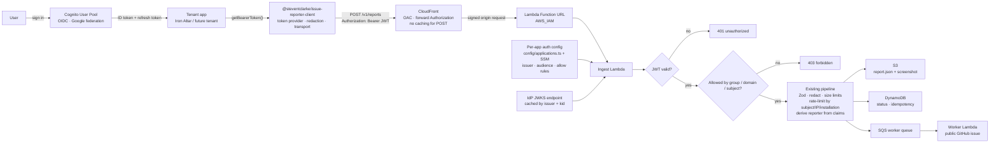

# Design: SSO Bearer JWT Authentication for Issue Intake

**Status:** Approved. This is an optional mode for `POST /v1/reports`; the existing anonymous
mode remains available for tenants that want maximum feedback volume. Phase 3 adds the client
token provider and contract; Phase 5 adds backend verification and enforcement.

## Goal

Limit issue reporting to an approved subset of users while keeping the current platform-global
backend and the app-agnostic core contract. The tenant's existing SSO becomes the source of
identity; the backend verifies that identity instead of trusting the `reporter` field supplied by
the client.

Use a **Cognito user pool federated with the tenant's existing IdP** (for example Google) as the
recommended token issuer. An identity pool is not needed because the client only calls this
backend; it never needs direct AWS credentials. Accepting IdP ID tokens directly is possible, but
Cognito gives one issuer, group membership, token revocation, and per-app audiences across
tenants.

## Current gap

The Function URL is protected by `AWS_IAM` with CloudFront OAC, but that only proves the request
came through CloudFront. It does not prove who the end user is. The `Origin` header, honeypot, and
`installationId` are abuse friction; they are not authentication. Today `reporter` is
self-asserted, so it must not be used for access control.

## What `getBearerToken()` does

`getBearerToken()` is a callback supplied by the tenant app, not a credential source and not a
security check. The tenant app has already signed the user in with its SSO provider and holds a
short-lived Cognito ID token. The callback simply returns the current token (refreshing it first
when needed) so the reporter can attach it to the request. A forged string is rejected because
only the IdP can sign a token that passes ingest verification.

## Architecture



The rendered diagram is committed as
[`diagrams/issue-reporting-auth-sso-jwt.svg`](diagrams/issue-reporting-auth-sso-jwt.svg).

## Request flow

1. The tenant app signs the user in with authorization code + PKCE. Public browser/mobile clients
   must not have a client secret.
2. The app reads a short-lived token from secure storage and passes a token provider to the
   client library: `auth: { getBearerToken: async () => token }`. The callback is a getter; the
   app owns the SSO session and the client never mints or validates tokens.
3. The client adds `Authorization: Bearer <token>` to `POST /v1/reports`. It never puts the token
   in the request body, diagnostics, or logs. If the provider returns `null`, the header is
   omitted and the backend rejects the request.
4. CloudFront forwards the header to the Function URL. `OPTIONS` remains unauthenticated so CORS
   preflight works; the CORS allowlist must include `authorization`.
5. Ingest parses the body, resolves the per-app config from `app`, then authenticates before
   redaction and side effects.
6. On success, ingest derives `reporter` from verified claims and overwrites any client-supplied
   `reporter`. Anonymous apps keep the current optional, self-asserted field.
7. Existing validation, redaction, rate limits, S3 writes, DynamoDB writes, and SQS enqueue remain
   unchanged, except that authenticated apps get an additional rate-limit key: the token subject.

## Per-app configuration

```ts
type IssueIntakeAuthConfig =
  | { mode: 'none' }
  | {
      mode: 'oidc';
      issuer: string;
      audience: string;
      tokenUse: 'id';
      allowedGroups?: string[];
      allowedEmailDomains?: string[];
      allowedSubjects?: string[];
      clockToleranceSeconds?: number;
      jwksCacheTtlSeconds?: number;
    };
```

Rules:

- `issuer` and `audience` are public configuration, not secrets. They live in
  `config/applications.ts` and are published through the existing `APP_CONFIG` SSM path.
- `audience` is the tenant app client ID. It prevents a token issued for another tenant from being
  accepted by this endpoint.
- Authorization is default-deny: the tenant binding must pass, and at least one configured
  predicate must match. Prefer `allowedGroups` (for example `issue-reporter-beta`); use
  `allowedEmailDomains` only as a secondary convenience and `allowedSubjects` for exact allowlists.
- Require `email_verified` before trusting an email claim for reporting or display.

## Token validation

Use `aws-jwt-verify` rather than hand-rolling JWT verification. On every request:

- fetch the issuer JWKS from `/.well-known/jwks.json`, matched by `kid`;
- verify the RS256 signature and `iss`, `aud` (or `client_id`), `exp`, `nbf`, and `token_use`;
- allow a small clock skew, default 60 seconds;
- refresh the JWKS on unknown `kid` or TTL expiry, with a bounded timeout;
- fail closed when the IdP or JWKS is unavailable.

Use the **ID token** when the reporter identity needs email/name/group claims. Use an **access
token** only for scope-based authorization; do not assume custom access-token claims are available
on the entry Cognito plan. Store refresh tokens in platform secure storage (Keychain/Keystore or
httpOnly cookies where applicable), enable refresh-token rotation and revocation, and keep access
token lifetimes short.

If the ingest Lambda is VPC-attached, it needs egress to the JWKS endpoint via NAT or an equivalent
path; otherwise keep it outside the VPC. Cache JWKS per issuer in module state so cold starts are
the main fetch cost.

## Contract and client changes

Implemented in Phase 3:

- Add `unauthorized`, `forbidden`, and `auth_unavailable` to `ERROR_CODES` in core. Keep
  `forbidden_origin` for the existing origin check.
- Add optional `reason` to error responses, limited to metadata codes such as `missing_token`,
  `invalid_token`, `expired_token`, `not_allowed`, `token_provider_failed`, and
  `auth_unavailable`.
- Extend the response table: `401 { error: 'unauthorized' }`, `403 { error: 'forbidden' }`,
  `503 { error: 'auth_unavailable' }`.
- Extend `IssueReporterConfig` with `auth?: { getBearerToken(): Promise<string | null> }`. When the
  provider returns `null`, the header is omitted and the backend returns `401`. When it throws,
  the client fails locally with `unauthorized` / `token_provider_failed` and does not send.
- Map `401` to client code `unauthorized`, `403` with `forbidden` to `forbidden`, and `503` to
  `auth_unavailable`. Existing `403 forbidden_origin` remains distinct.
- Add diagnostics events `auth_required` and `auth_failed`, carrying only a reason code. Never emit
  the token or raw claims.

Deferred to Phase 5: backend verification, allowlist enforcement, reporter derivation from claims,
and subject-based rate limiting.

## Ingest changes

Insert an auth step after body parse/app resolution and before validation/redaction:

```ts
const appConfig = resolveAppConfig(request.app);
if (appConfig.issueIntake.auth.mode === 'oidc') {
  const claims = await verifyBearerToken(requestAuthorizationHeader, appConfig.issueIntake.auth);
  assertAllowed(claims, appConfig.issueIntake.auth);
  request.reporter = toReporter(claims);
}
```

Structured logs continue to carry only `reportId`, `app`, and `status`, plus an `authReason`
metadata code when auth fails. Do not log `Authorization`, the decoded token, or claim values.
Rate-limit by `sub` in addition to installation ID and viewer IP; token replay within its short TTL
is then bounded by the same counter.

## Security and privacy

- This stops anonymous and unauthorized submissions, not compromised accounts. Keep WAF/rate
  limits, size caps, honeypot, and alarms.
- The public GitHub issue already contains reporter identity under the explicit public-report
  acknowledgement. Make that acknowledgement prominent for authenticated apps, and consider
  showing the resolved name/email in the preview.
- Tokens are bearer credentials: TLS only, no token in URLs, no token in CloudFront logs,
  short TTL, revocation/disable in the user pool as the kill switch.
- Scope tokens to the reporter app audience. Do not reuse one app client across unrelated tenants.

## Alternatives considered

| Option                                           | Why not primary                                                                                                              |
| ------------------------------------------------ | ---------------------------------------------------------------------------------------------------------------------------- |
| API Gateway HTTP API JWT authorizer              | Managed validation, but changes the CloudFront → Function URL topology; custom claim authorization still needs backend code. |
| Lambda@Edge / CloudFront Function JWT validation | Fails earlier, but duplicates validation logic and complicates JWKS caching; ingest validation is simpler.                   |
| API keys or signed app tokens                    | Identify the client, not the user; mobile secrets are extractable.                                                           |
| mTLS / device attestation                        | Good for trusted devices, poor fit for an end-user feedback channel and much heavier operationally.                          |

## Rollout and tests

1. Add the contract/error-code and client token-provider changes.
2. Add the ingest auth module, JWKS cache, claim policy, and unit tests with a local IdP/JWKS stub.
3. Enable `mode: 'oidc'` for one app in preview, then prod after observing `auth_failed` reasons.
4. Keep other apps in `mode: 'none'` so the public intake path is unchanged.

Required tests: missing/malformed/expired token, wrong issuer, wrong audience, wrong `token_use`,
unknown `kid`, JWKS rotation, group allowed/denied, email-domain allowed/denied, subject
allowlist, cross-tenant token replay, IdP outage, `OPTIONS` without token, and assertions that no
token or raw claim reaches logs, diagnostics, S3, or the GitHub issue body.
